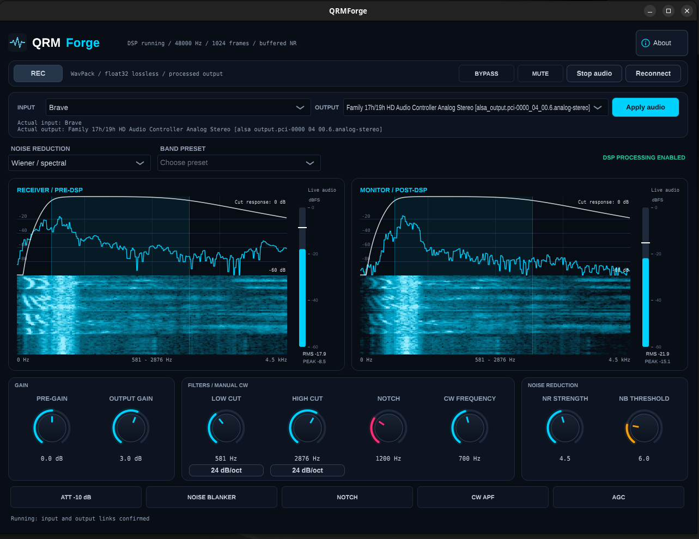

# QRMForge

Audio DSP for amateur radio and broadcast listening on Linux, with a particular focus on HF reception.



## Download or build

Choose how to run QRMForge:

| Option | Steps |
| --- | --- |
| Download an AppImage | Open [GitHub Releases](https://github.com/logocomune/qrmforge/releases) and download `QRMForge.AppImage` from a published release. Releases also include `QRMForge.AppImage.tar.gz`, `QRMForge-source.tar.gz` and `SHA256SUMS`. |
| Build and run from source | Install the [build dependencies](#build), then run `make run` from the project root. It compiles the application and launches it. |
| Build your own AppImage | Install the build dependencies plus `curl`, then run `make appimage`. The result is `dist/QRMForge.AppImage`. See [portable distribution](#portable-distribution). |

To launch a downloaded AppImage:

```sh
chmod +x QRMForge.AppImage
./QRMForge.AppImage
```

If FUSE is unavailable, run `APPIMAGE_EXTRACT_AND_RUN=1 ./QRMForge.AppImage`. AppImages target x86-64 Linux with Ubuntu 24.04-class glibc; PipeWire and a desktop session manager are required on the host.

### Start listening

1. Select **INPUT** and **OUTPUT**, then press **Apply audio**.
2. Disable **BYPASS** to enable processing.
3. Press **Stop audio** to release the audio routes.

If you use RTP, configure reception in PipeWire before starting QRMForge. See the [desktop layout and controls](docs/usage.md#desktop-layout) for more details.

## Why QRMForge?

Tuning a station is only the beginning of listening. On HF, a distant broadcast, an SSB conversation or a CW signal often shares the headphones with background hiss, impulsive noise and persistent whistles. Receiver audio can carry the information you want while still being tiring to follow over a long listening session.

QRMForge was created to put practical audio processing between the receiver and the listener. The aim is to make received audio easier to follow and more comfortable to listen to, with controls you can adjust by ear as conditions change. Narrow the bandwidth around a voice, reduce a steady whistle with the manual notch, try noise reduction on speech, or emphasize the tone of a CW signal. For broadcast listening, balance noise suppression against the detail and character of the programme; for amateur radio, shape the audio around the signal you are trying to copy.

Input/output spectra and waterfalls help you see what changes, while bypass lets you compare directly with the original audio. Lossless recording captures the output for later listening. Processing stays local, and the choice of filters and noise reduction stays with the listener. Results depend on the received signal: audio processing can reduce distractions, but cannot restore information already lost in reception.

## How it fits your station

QRMForge is an independent desktop application with a JUCE interface and native PipeWire input/output. DSP runs inside the application. No LADSPA plugin, shared-memory service, persistent PipeWire profile or audio-service restart is required.

QRMForge processes audio from an existing radio receiver, SDR application, network/RTP receiver or other PipeWire source. It helps adjust the listening bandwidth, reduce interference and noise, and monitor the result before sending it to headphones or another output. It processes mono audio; stereo outputs receive the same signal on both channels. Radio tuning, demodulation and RTP reception are handled by the source application, not by QRMForge.

The desktop provides input/output spectra and waterfalls, PRE/POST RMS and sample-peak meters in dBFS, band presets, adjustable DSP controls and lossless recording. Processing and neural inference run locally; the application does not use a cloud noise-reduction service.

## Filters and controls

DSP means **digital signal processing**. CW means **continuous wave**, used here for Morse reception; SSB means **single sideband**. QRMForge offers the following controls:

| Control | Meaning and purpose |
| --- | --- |
| PRE-GAIN | Adjusts the signal level before the filters and noise reduction. Excessive gain can cause distortion later in the chain. |
| ATT -10 dB | Attenuates the input by 10 dB before processing. It cannot repair clipping already present in the source. |
| LOW CUT / HPF | High-pass filter: reduces frequencies below the selected cutoff, such as low-frequency rumble. |
| HIGH CUT / LPF | Low-pass filter: reduces frequencies above the selected cutoff, narrowing the listening bandwidth. |
| 12 / 24 dB/oct | Independent cutoff slopes. A 24 dB/oct slope rejects out-of-band frequencies more steeply; neither setting is a brick-wall filter. |
| NOISE BLANKER / NB THRESHOLD | Suppresses short impulsive disturbances by briefly holding the previous sample. Lower thresholds trigger more easily and can also affect wanted audio. |
| NOTCH | Manually tuned narrow rejection filter for a persistent tone or whistle. Set its frequency to the interference; there is no automatic tone tracking. |
| CW APF / CW FREQUENCY | Audio peak filter: boosts a narrow region around a manually chosen Morse tone. It does not decode or automatically follow CW. |
| OUTPUT GAIN | Adjusts level after filtering and noise reduction, before optional AGC and the final limiter. |
| AGC | Automatic gain control: reduces level variations using fast attenuation and slower recovery. It is optional, starts off and is not noise reduction. |
| BYPASS | Sends the raw input to the output, skipping filters, gains, AGC and the processing limiter. MUTE still takes precedence. |
| MUTE | Silences the output, including the recorded output. Input monitoring remains available. |

The final hard limiter bounds processed samples to ±1. It is always part of the enabled processing chain, not a separate GUI switch, and can itself introduce clipping when driven too hard.

### Noise reduction modes

Only one NR mode runs at a time. Stronger suppression can remove wanted details or introduce artifacts; compare settings with bypass.

| Mode | Brief explanation | Restrictions in this application |
| --- | --- | --- |
| OFF | Disables noise reduction; the other enabled DSP stages still operate. | Always available. |
| NLMS | Normalized least-mean-squares adaptive predictor. Uses delayed audio to estimate correlated signal components, which can help preserve voice or CW while reducing uncorrelated noise. | Voice and CW; NR STRENGTH adjusts adaptation. |
| RNNoise | Neural speech denoiser using the bundled Xiph.Org model. | Voice only, 48 kHz; NR STRENGTH has no effect on its fixed model. |
| Wiener | Spectral denoiser that estimates a noise floor and attenuates frequency bins accordingly. Steady wanted tones can also be reduced. | Voice and CW; NR STRENGTH adjusts suppression. |
| SpeexDSP | Speech-oriented preprocessing denoiser. | Voice only, 8–48 kHz; NR STRENGTH sets a suppression limit. |
| DeepFilterNet | Neural speech enhancement using a bundled native backend and model in a private helper process. | Voice only, 48 kHz, bundled backend for x86-64 Linux; NR STRENGTH sets an attenuation limit. |

On first selection, DeepFilterNet loads in the background and the status line shows its progress.

Voice-only modes are disabled while CW APF is active. Missing backends or incompatible sample rates disable the affected menu choices. Frame-based backends add buffering; the GUI's sample-rate/block-size display is not a measurement of end-to-end latency.

AM, FM, SSB and SSB DX presets select audio bandwidths, not radio demodulation modes. The CW preset also enables manual APF and selects NLMS. See [processing order, exact presets and backend behavior](docs/usage.md#dsp-controls).

## Record audio

Start audio, press **REC**, choose a new `.wv` filename, then press **Stop REC** to finish. Recording saves the actual processed mono output, including bypass and mute, using fast lossless **32-bit float WavPack**. Stop audio, source changes, reconnect and application exit finalize the recording. Files are never overwritten. See [recording behavior](docs/usage.md#recording).

## Build

Build requirements on Ubuntu 24.04 include CMake 3.22+, a C/C++17 compiler, Make, pkg-config, JUCE 7 module sources and PipeWire 1.0+ development headers:

```sh
sudo apt install build-essential cmake pkg-config python3 juce-modules-source \
  libpipewire-0.3-dev libspeexdsp1 libwavpack1 libfreetype-dev libx11-dev libxcomposite-dev \
  libxcursor-dev libxext-dev libxinerama-dev libxrandr-dev libxrender-dev
make test
make run
```

To launch an existing build directly, run `./build/qrmforge_artefacts/Release/qrmforge`.

The source tree includes the RNNoise archive and model; compiling the application does not download dependencies. LADSPA development headers are not needed. QRMForge builds independently from this project root. If you move the source directory, regenerate its CMake cache before rebuilding. With CMake 3.24 or later, run `cmake --fresh -S . -B build`. With CMake 3.22 or 3.23, build in a new directory, for example `make build BUILD_DIR=build-fresh`.

Wiener uses a local FFT implementation. SpeexDSP uses the installed native runtime, bundled into portable packages. DeepFilterNet uses a bundled, checksum-pinned v0.5.6 native backend in a private helper process; no separate model setup is required on x86-64 Linux. See [backend details](docs/usage.md#noise-reduction-backends). No Python runtime or model downloads are used by the application.

```sh
make test GUI=OFF
make fuzz GUI=OFF
```

Use separate build directories when comparing options: `make test BUILD_DIR=build-no-rnnoise RNNOISE=OFF GUI=OFF`.

Run `make clean` to remove compiled build artifacts. Use the same `BUILD_DIR` as the build when overriding the default.

See [usage and maintenance](docs/usage.md), [validation evidence](docs/validation.md) and [implementation plan](docs/implementation-plan.md).

## Portable distribution

On Ubuntu 24.04, AppImage packaging also requires the PipeWire and SPA runtime modules, in addition to the build dependencies:

```sh
sudo apt install curl libpipewire-0.3-modules libspa-0.2-modules
```

A portable AppDir and `.tar.gz` can be built without downloading packaging tools:

```sh
python3 packaging/build_portable.py \
  --binary build/qrmforge_artefacts/Release/qrmforge \
  --output dist
./dist/QRMForge.AppDir/AppRun
```

Use a fresh output directory for every package. For AppImage creation, additionally provide a locally obtained, reviewed `appimagetool` and its verified SHA-256 with `--appimagetool /absolute/path --tool-sha256 SHA256`. The script never obtains or executes an unpinned downloaded tool automatically.

Build and package an AppImage with Make:

```sh
make appimage
```

The target builds the GUI, downloads official x86-64 `appimagetool` and runtime assets, verifies their pinned SHA-256 digests, and writes `dist/QRMForge.AppImage`. Python 3 and `curl` are required. Verified tools are cached under `build/appimage-tools`; subsequent builds can reuse them offline. Use `PACKAGE_DIR=another-directory` to select the destination. Each build uses a temporary staging directory and replaces the final AppImage only after packaging succeeds.

Pushing a `v*` tag runs the GitHub Actions release workflow, which publishes the AppImage, a compressed copy, a source archive and SHA-256 checksums. See [release maintenance](docs/usage.md#appimage-releases).

This build targets Ubuntu 24.04-class x86-64 desktops; compatibility with older glibc versions or other architectures is not established. PipeWire and a desktop session manager remain host runtime requirements. Read the licensing and distribution notes in [usage](docs/usage.md#packaging-and-licenses).

## Libraries and acknowledgements

These are the direct libraries and interfaces used by the standalone build. Acknowledgements do not replace the required copyright notices, license texts or source-distribution obligations.

| Component | Use | License / attribution |
| --- | --- | --- |
| [JUCE 7.0.5](https://github.com/juce-framework/JUCE/tree/7.0.5) — Raw Material Software Ltd | Desktop UI, graphics, FFT monitoring and application support. | GPLv3 option for the GUI modules in the configured distribution package; some JUCE modules are ISC. Upstream also offered alternative JUCE 7 terms. See the [version-specific license](https://github.com/juce-framework/JUCE/blob/7.0.5/LICENSE.md). |
| [PipeWire](https://pipewire.org/) — PipeWire contributors | Native audio graph, device discovery and routing. | Core license is MIT/Expat; bundled modules and dependencies retain their individual notices. |
| [RNNoise 0.2](https://github.com/xiph/rnnoise) — Xiph.Org and contributors | Neural speech denoising with bundled default model. | BSD-style, three-clause terms; retain [COPYING](third_party/rnnoise/COPYING), including all listed copyright holders. |
| [SpeexDSP 1.2.1](https://github.com/xiph/speexdsp/tree/SpeexDSP-1.2.1) — Xiph.Org and contributors | Native speech denoising. | BSD-3-Clause; retain the upstream header notice and runtime copyright/license. |
| [DeepFilterNet v0.5.6](https://github.com/Rikorose/DeepFilterNet/tree/v0.5.6) — Hendrik Schröter and contributors | Native speech-enhancement backend and embedded model. | Code and official model weights are MIT OR Apache-2.0; this project retains the [MIT option](third_party/deepfilter/LICENSE-MIT). See the maintainer's [model-weight clarification](https://github.com/Rikorose/DeepFilterNet/commit/7b14b89). |
| LADSPA interface — Richard W. E. Furse, Paul Barton-Davis and contributors | Compatibility header for the private DeepFilterNet backend; no host plugin installation required. | LGPL-2.1-or-later header notice and license retained under `third_party/deepfilter/`. |
| [WavPack 5.6.0](https://github.com/dbry/WavPack/tree/5.6.0) — David Bryant | Lossless float32 recording. | BSD-3-Clause; retain [LICENSE](third_party/wavpack/LICENSE). |

NLMS, Wiener, bandwidth/notch/APF filters, noise blanker and standalone AGC are implemented in the project's C++ DSP code; they are not additional external denoising libraries.

Portable packages also bundle system libraries for graphics, fonts, compression and runtime support. Their distribution notices are copied to `QRMForge.AppDir/usr/share/licenses/`; the AppImage additionally contains its separately licensed runtime. See [dependency provenance](third_party/README.md) and the [licensing review and remaining work](docs/usage.md#license-review-and-recommendation).

The About dialog includes offline third-party credits and license texts. Portable packages also include distribution notices, common license texts and package versions. See [license review and remaining release checks](docs/usage.md#offline-third-party-notices).

DeepFilterNet's [conservative dependency inventory](third_party/deepfilter/INVENTORY.json) and retained third-party notices cover the reviewed crate closure and Rust toolchain. Optional, build and non-Linux entries are identified as conservative coverage; exact binary composition and AppImage runtime verification remain separate release checks. See [inventory maintenance](docs/usage.md#deepfilternet-dependency-notice-maintenance).

## License

Copyright (c) 2026 Alessandro Lucaferro.

QRMForge's own code, accompanying documentation and project-owned artwork are licensed under the **GNU General Public License, version 3 only (`GPL-3.0-only`)**. You may redistribute and modify them under version 3 of that license. See [LICENSE](LICENSE) for the full terms. The program is provided without warranty, including any implied warranty of merchantability or fitness for a particular purpose.

This choice fits the current JUCE 7.0.5 GPL-based GUI build. Third-party code and models retain their own copyright notices and licenses; the project license does not replace them. Preserve all applicable notices and provide the required corresponding source/build materials when distributing the application. A README credit alone is insufficient. See [licensing and distribution obligations](docs/usage.md#license-review-and-recommendation).
